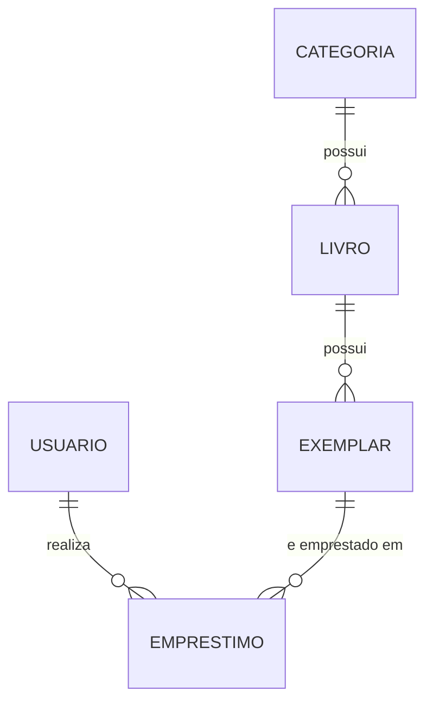

# Sistema de Biblioteca

API REST para gerenciar o acervo de uma biblioteca: categorias, livros, exemplares físicos, usuários e empréstimos. Projeto de estudo desenvolvido com Java e Spring Boot, organizado em camadas (Controller, Service e Repository), com validação de dados, tratamento global de erros e testes unitários.

## Tecnologias

- Java 17 ou superior
- Spring Boot 4 (Spring Web MVC)
- Spring Data JPA / Hibernate
- PostgreSQL
- Bean Validation (`jakarta.validation`)
- JUnit 5 e Mockito
- Maven

## Modelo de dados



- **Categoria**: agrupa os livros (ex.: Romance, Ficção).
- **Livro**: título e autor, ligado a uma categoria.
- **Exemplar**: cópia física de um livro, com código de barras e status.
- **Usuário**: pessoa que pega livros emprestados (nome e e-mail).
- **Empréstimo**: liga um usuário a um exemplar, com as datas de empréstimo e devolução.

## Como rodar

### Pré-requisitos

- JDK 17 ou superior
- PostgreSQL instalado e em execução
- Maven (ou o wrapper `./mvnw` que já vem no projeto)

### 1. Clonar o repositório

```bash
git clone <url-do-repositorio>
cd sistema-biblioteca
```

### 2. Criar o banco de dados

No pgAdmin, ou pelo `psql`, crie o banco:

```sql
CREATE DATABASE sistema_biblioteca;
```

As tabelas são criadas automaticamente pelo Hibernate na primeira execução (`spring.jpa.hibernate.ddl-auto=update`).

### 3. Configurar a senha do banco

A senha não fica no código. O `application.properties` lê a variável de ambiente `DB_PASSWORD`:

```properties
spring.datasource.url=jdbc:postgresql://localhost:5432/sistema_biblioteca
spring.datasource.username=postgres
spring.datasource.password=${DB_PASSWORD}
```

Defina a variável com a senha do seu PostgreSQL.

**PowerShell (Windows):**

```powershell
$env:DB_PASSWORD="sua_senha"
```

**Linux / macOS:**

```bash
export DB_PASSWORD=sua_senha
```

**IntelliJ:** em *Run > Edit Configurations*, no campo *Environment variables*, informe `DB_PASSWORD=sua_senha`.

Se o seu PostgreSQL usa outra porta ou outro usuário, ajuste `spring.datasource.url` e `spring.datasource.username` no `application.properties`.

### 4. Subir a aplicação

```bash
./mvnw spring-boot:run
```

A API fica disponível em `http://localhost:8080`.

## Endpoints

| Recurso | Método | Rota | Descrição |
|---|---|---|---|
| Categorias | GET | `/categorias` | Lista todas as categorias |
| Categorias | GET | `/categorias/{id}` | Busca uma categoria por id |
| Categorias | POST | `/categorias` | Cadastra uma categoria |
| Categorias | DELETE | `/categorias/{id}` | Remove uma categoria |
| Livros | GET | `/livros` | Lista todos os livros |
| Livros | GET | `/livros/{id}` | Busca um livro por id |
| Livros | POST | `/livros` | Cadastra um livro |
| Livros | DELETE | `/livros/{id}` | Remove um livro |
| Exemplares | GET | `/exemplares` | Lista todos os exemplares |
| Exemplares | GET | `/exemplares/{id}` | Busca um exemplar por id |
| Exemplares | POST | `/exemplares` | Cadastra um exemplar |
| Exemplares | DELETE | `/exemplares/{id}` | Remove um exemplar |
| Usuários | GET | `/usuarios` | Lista todos os usuários |
| Usuários | GET | `/usuarios/{id}` | Busca um usuário por id |
| Usuários | POST | `/usuarios` | Cadastra um usuário |
| Usuários | DELETE | `/usuarios/{id}` | Remove um usuário |
| Empréstimos | GET | `/emprestimos` | Lista todos os empréstimos |
| Empréstimos | GET | `/emprestimos/{id}` | Busca um empréstimo por id |
| Empréstimos | POST | `/emprestimos?usuarioId=1&exemplarId=1` | Registra um empréstimo |
| Empréstimos | DELETE | `/emprestimos/{id}` | Remove um empréstimo |

### Exemplos de requisição

**Cadastrar uma categoria**

```http
POST /categorias
Content-Type: application/json

{
  "nome": "Romance"
}
```

**Cadastrar um livro**

```http
POST /livros
Content-Type: application/json

{
  "titulo": "Dom Casmurro",
  "autor": "Machado de Assis",
  "categoria": { "id": 1 }
}
```

**Registrar um empréstimo**

O empréstimo recebe apenas os ids, como parâmetros de consulta. O serviço busca o usuário e o exemplar no banco e monta o empréstimo.

```http
POST /emprestimos?usuarioId=1&exemplarId=1
```

## Códigos de resposta

| Status | Quando acontece |
|---|---|
| `200 OK` | Consulta realizada com sucesso |
| `201 Created` | Registro criado com sucesso |
| `204 No Content` | Registro removido |
| `400 Bad Request` | Dados inválidos (validação falhou) |
| `404 Not Found` | Registro não encontrado |

## Tratamento de erros

Os erros são tratados de forma centralizada por uma classe `@ControllerAdvice` (`GlobalExceptionHandler`).

**Registro não encontrado** (`404`): o corpo da resposta traz uma mensagem de texto, como `Livro nao encontrado`.

**Dados inválidos** (`400`): o corpo traz cada campo com problema e a mensagem correspondente. Por exemplo, ao enviar um livro sem título e sem autor:

```json
{
  "titulo": "O titulo e obrigatorio",
  "autor": "O autor e obrigatorio"
}
```

A validação usa `@NotBlank` e `@NotNull` nas entidades, ativadas com `@Valid` nos controllers.

## Testes

Os services possuem testes unitários com JUnit 5 e Mockito. Os repositórios são simulados com mocks, então os testes rodam sem banco de dados.

```bash
./mvnw test
```

## Estrutura do projeto

O projeto segue a divisão em camadas:

- **controller**: recebe as requisições HTTP e devolve as respostas (`ResponseEntity`).
- **service**: concentra as regras de negócio e lança as exceções.
- **repository**: interfaces do Spring Data JPA para acesso ao banco.
- **entities**: entidades JPA e suas validações.
- **exception**: tratamento global de erros.

## Próximos passos

- Endpoints de atualização (`PUT`)
- DTOs para separar o que trafega na API do que é persistido
- Regras de negócio no empréstimo (exemplar disponível, prazo de devolução)
- Autenticação com Spring Security
- Execução com Docker
